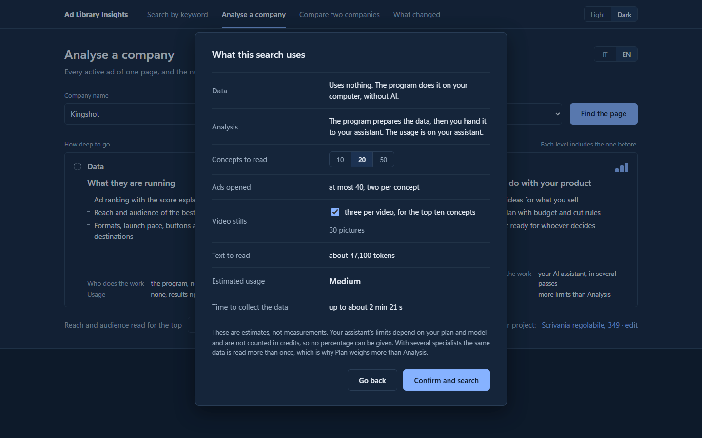

# Ad Library Insights

**See what a competitor really keeps running on Meta, and why, without an account, a token or a paid tool.**

[](pyproject.toml)
[](LICENSE)
[](#tests)

Ad Library Insights reads the public Meta Ad Library and turns it into research you can act on: a
ranked list of the ads a company keeps on air, how many people each one reaches per day, how its
copy is built, and a data pack your own AI assistant can turn into an analysis or a plan.

It is a local web app, a command-line tool and an MCP server. Everything runs on your computer.


## The problem it solves

The Ad Library shows every ad a company is running, as an endless wall of cards. It does not tell
you which of those ads matter. Paging through hundreds of near-identical cards to guess what works
is slow, and the guess is usually "the oldest one".

Ad Library Insights does the reading for you:

- **One row per idea, not per card.** Identical copies, automatic versions, catalogue ads and
  translations are merged into one concept, so 200 cards become the 14 ideas behind them.
- **A rating you can question.** Every concept gets 0-100 points from three parts that are always
  shown: scale (people reached per day in the country you searched), staying power (days on air)
  and creative investment (how many different creatives carry the same text). Each rating says how
  reliable it is and what it was measured on.
- **Honest numbers.** A figure always says what it measures and on whom. An estimate is never shown
  as data. Where Meta publishes no reach, the app says so instead of filling the gap.
- **No AI bill from the tool.** The program is plain code. For the Analysis and Plan levels it
  prepares the data and you hand it to the assistant you already use.

## Three levels


| Level | What you get | What it uses |
|---|---|---|
| **Data** | The ranked concepts, days on air, reach and audience, and how the company advertises: formats, launch pace, languages, buttons, destinations. | Nothing: plain code, no AI. |
| **Analysis** | A data pack and a ready text for your own assistant, to explain what the company runs and why it reaches what it reaches, with evidence for every claim. | Your assistant's limits. |
| **Plan** | The analysis applied to your product: ad ideas, a test plan with budgets and a cut rule computed from your margin, and a one-page report. | More of your assistant's limits. |

Before an Analysis or a Plan the app shows what will be read and an estimate of the size, and waits
for your confirmation. It is an estimate: limits depend on your plan and model.



A full example made from one real search is in [`examples/`](examples): the
[analysis](examples/kingshot-it-2026-11-14/analisi.md), the
[plan](examples/kingshot-it-2026-11-14/piano.md) and the data pack both were written from. A test
checks that every figure in the two texts is written in the pack.

## What else it does

- **Search by keyword** in any country, or **analyse one company** from its page.
- **Compare two companies** on the same numbers, with the differences written out. It names no
  winner, because the Ad Library shows no spend and no sales.
- **What changed**: every search is saved locally; from the second search of the same company or
  keyword it lists new ads, ads no longer on air and ads whose copy, button or destination changed.
- **Copy breakdown**: hook, promise, proof and call to action of the best ads, as structured output.
- **Reports**: a Markdown brief and a CSV with one row per ad.
- **Break-even check**: your break-even cost per purchase from price and costs, and the list of your
  own ads that spent two to three times that with no add to cart and no sale.
- **Italian and English** interface, light and dark theme.


## Installation

Requires Python 3.10 or newer.

**Windows (PowerShell)**

```powershell
py -m venv .venv
.venv\Scripts\Activate.ps1
pip install -e .
python -m playwright install chromium
```

**macOS / Linux**

```bash
python3 -m venv .venv
source .venv/bin/activate
pip install -e .
python -m playwright install chromium
```

If PowerShell refuses to run the activation script, run
`Set-ExecutionPolicy -Scope CurrentUser RemoteSigned` once, or skip activation and call
`.venv\Scripts\python.exe -m ad_library_insights` in place of `ad-library-insights`.

## Open the app

```bash
ad-library-insights app
```

The app opens in your browser and runs on your computer only (`127.0.0.1`). On Windows you can also
double-click `avvia.bat`: the first time it creates the environment and installs everything, after
that it just opens the app.

1. Choose a mode (keyword, company, compare, what changed), a country and a level.
2. For a company, type its name and pick the right page from the list.
3. Choose how many concepts to read in depth (10, 20 or 50). A concept is one text with every ad
   that carries it. For each, the program opens its most shown ad, then its second and third, up to
   a ceiling of two ads opened per concept asked. If the ceiling stops the reading, the result says so.
4. For Analysis and Plan, press "Prepare analysis" or "Prepare plan" and paste the text into your
   assistant, or use the pack with Claude Code as described below.


## Analysis and Plan with your own assistant

The program never calls a model. For these two levels it writes the data and you choose who reads it.

- **Any assistant, one pass.** "Copy for your assistant" copies one text with role, method, rules of
  evidence and the data inside. Paste it into the assistant you use.
- **Claude Code, with specialists.** The same data is saved as a pack: `overview.md` and one file
  per specialist (`copy.md`, `creative.md`, `reach.md`, `testing.md`, plus `project.md` for a plan).
  The four sub-agents in `.claude/agents/` each read only their own file; the skills
  `competitor-analysis` and `competitor-plan` coordinate them and join the findings. Open this
  repository in Claude Code so the agents are found, and install the skills.

A plan needs your project card: product, price, product cost, market, goal and main problem. It is
asked once and kept on your computer. The amounts of the plan (margin, break-even, test budgets, cut
rule) are computed by the program from that card, not written by the assistant.

### Skills

Copy the folders inside `skills/` to `~/.claude/skills/` (all projects) or to `.claude/skills/` in a
project.

| Skill | Use it to |
|---|---|
| `ad-library-research` | Map a market or a competitor and see how the ads that stay on air are written. |
| `competitor-analysis` | The Analysis level: copy, creative, reach and audience, testing and destinations, joined into causes with their evidence. |
| `competitor-plan` | The Plan level: diagnosis of your project, five ad ideas, a test plan built on break-even, a one-page report. |
| `breakeven-cpa-check` | Decide which of your own ads to cut, from your margin and an Ads Manager export. |
| `weekly-competitor-report` | Track a fixed watchlist and report what is new, what stopped and what changed. |

## Use it as an MCP server

Point the client at the Python interpreter of the virtual environment.

Claude Code:

```bash
claude mcp add ad-library-insights -- /absolute/path/.venv/bin/python -m ad_library_insights
```

On Windows the interpreter is `C:\absolute\path\.venv\Scripts\python.exe`.

Claude Desktop (`claude_desktop_config.json`):

```json
{
  "mcpServers": {
    "ad-library-insights": {
      "command": "C:\\absolute\\path\\.venv\\Scripts\\python.exe",
      "args": ["-m", "ad_library_insights"]
    }
  }
}
```

Then ask in plain language; the client picks the tools.

| Tool | Purpose |
|---|---|
| `search_ads(country, query, advertiser, ..., deep_ads)` | Ranked concepts for a keyword and/or an advertiser name. `deep_ads` reads reach and audience for that many of the most shown concepts. |
| `find_advertiser_pages(name, country)` | The pages the library suggests for a name, with followers and category. |
| `analyze_company(country, page_id \| name, deep_ads, frames)` | Every active ad of one page, ranked, with company signals, reach and audience. |
| `compare_companies(country, page_id_a, page_id_b, deep_ads)` | Two pages side by side on the same numbers. |
| `what_changed(country, query \| page_id)` | New, stopped and changed ads since the previous search. |
| `estimate_consumption(level, ads, frames)` | Rough size of an Analysis or a Plan, to confirm before collecting. |
| `prepare_analysis(country, level, page_id \| query, ads, frames)` | Collects the data and writes the pack. |
| `get_project()` / `save_project(...)` | The project card the Plan level is written for. |
| `analyze_top_ads(country, query, advertiser, top_n)` | Hook, promise, proof and call to action of the top ads. |
| `export_report(country, output_dir, query, advertiser, top_n, formats)` | Writes the Markdown brief and/or the CSV. |
| `scrape_library_url(url, ...)` | The same ranking for an Ad Library address you filtered by hand. |
| `check_breakeven_cpa(price, product_cost, ..., ads \| csv_path)` | Break-even cost per purchase and the list of ads to cut. |

## Use it from the command line

```bash
ad-library-insights report --country DE --query "<keyword>" --top 10 --out reports
ad-library-insights pages --country US --name "<advertiser>"
ad-library-insights company --country US --page-id <page id> --deep 20 --out reports
ad-library-insights breakeven --price 60 --product-cost 20 --shipping-cost 5 --fee-pct 3 --csv export.csv
```

`pages` lists the advertiser pages matching a name; `company` analyses one of them. `--deep` is the
number of most shown concepts whose reach and audience are read (about three seconds per ad opened;
progress and time left are printed).

## How the rating works

1. **One ad per concept.** Identical copies, versions of a dynamic ad, catalogue ads and
   translations are merged. They do not count as different creatives.
2. **Scale, up to 60 points.** People reached per day in the country searched: people reached
   divided by the days on air, seven at the least. It is measured against the best ad of the same
   search, on a log scale. Where reach was not read, the scale is a prudent estimate from the
   position in Meta's list, never above the weakest ad that was read. Where Meta publishes no reach
   for that country, the position in the list is used and the rating says so.
3. **Staying power, up to 25 points.** Days the concept has been on air, full at 90.
4. **Creative investment, up to 15 points.** Different creatives carrying the same text, full at 10.
5. **Reliability.** High when reach in the country searched was read; medium when the scale comes
   from the position in the list; low when neither is known.
6. **Verdict.** Scaling, holding, testing, average, to review, or ended. An ad on air for less than
   seven days is "too recent to judge", whatever its numbers.

The weights never change. [docs/valutazione.md](docs/valutazione.md) shows the rating before and
after its corrections on three real searches, and [docs/controllo-qualita.md](docs/controllo-qualita.md)
lists what every number measures, the independent reviews and the hard cases.

## How it reads the library

1. **Render.** Playwright opens the public Ad Library page in headless Chromium and scrolls until no
   new ads load.
2. **Read.** Ads are taken from the data the page itself loads: text, button, destination, format,
   platforms, start date. The list is ordered by total impressions, highest first.
3. **Reach and audience.** For the most shown concepts the detail view of the ad is opened: reach in
   the country searched, in the EU and in the UK, age, gender, locations chosen or excluded.
4. **Fetch policy.** Results are cached on disk for six hours. Pages are requested at least 20
   seconds apart and at most 30 per hour. A page that shows no ads and no "no results" message is
   retried twice. Empty pages are never cached.
5. **Signals.** Plain code computes reach per day, audience breadth, format mix, new ads per week,
   languages, buttons, destinations and repeated copy.

Cache, saved pictures, saved searches and packs live in `~/.ad_library_insights` (override with the
`AD_LIBRARY_INSIGHTS_HOME` environment variable).

## Known limits

- **No spend and no sales.** The Ad Library does not publish them. The rating is a clue about what
  an advertiser keeps paying for, not a measure of profit.
- **Reach exists only for the EU and the UK.** Meta publishes reach and audience for ads delivered
  in the European Union or the United Kingdom. For a search elsewhere the app says that reach is not
  published and rates on the position in the list.
- **Reach is a floor for concepts split over many ads.** At most three ads of a concept are opened;
  next to every figure is how many of its ads were read.
- **Ads already stopped are not visible.** A single search shows what is on air today. How many ads
  a company cuts can be measured only from the second saved search of the same company.
- **It reads a web page, not an API.** A change in the page can break the reading until the parser
  is updated. When the page serves no ads the app reports it as blocked instead of "no ads".
- **Company analysis needs the right page.** Several pages can share a name: the app lists them and
  you choose. A brand that advertises from several pages is analysed page by page.
- **A start date resets when an ad is edited**, so frequently edited ads look younger than they are.
- **The copy breakdown is a first pass by rules**, in English, Italian, Spanish, French and German.
  Expect wrong labels on unusual copy.
- **The usage estimate is an estimate**, and with video stills it tends to run low.
- **Speed.** A fresh search takes roughly 10 to 40 seconds, a company with a few hundred ads about a
  minute, and each ad opened about three seconds.

## Tests

```bash
pip install -e ".[dev]"
python -m pytest
```

The suite runs offline: no test makes a real request. The browser is replaced by a scripted reader
and time by a fake clock; the interface tests run a local page in headless Chromium and are skipped
where Chromium is not installed.

## License

MIT. See [LICENSE](LICENSE).
