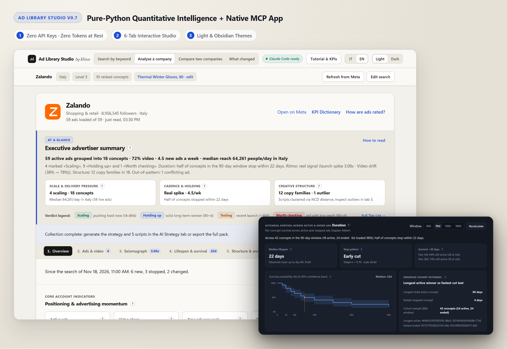
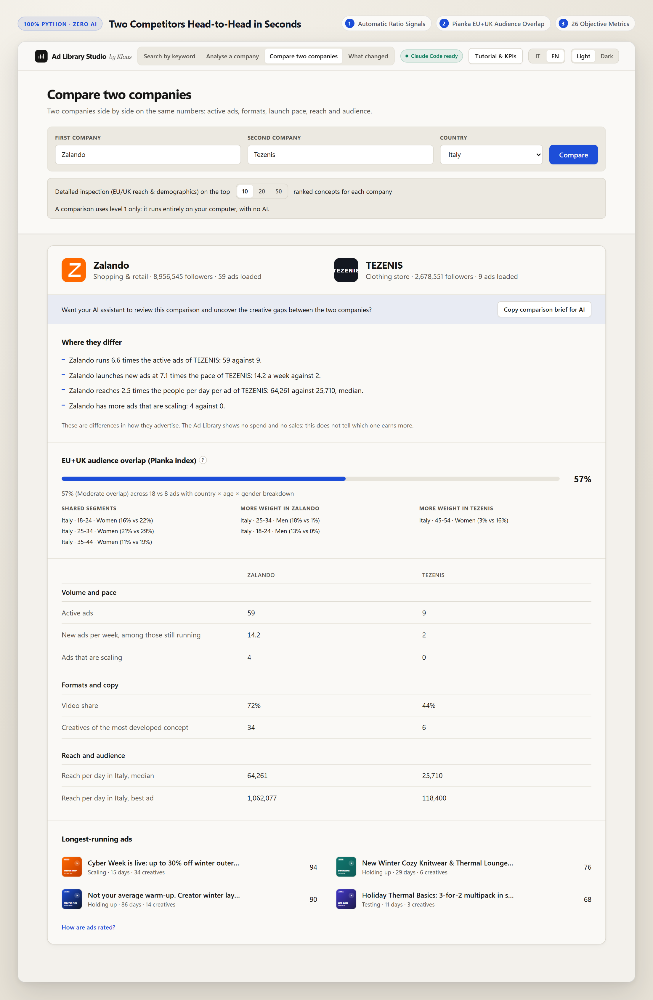
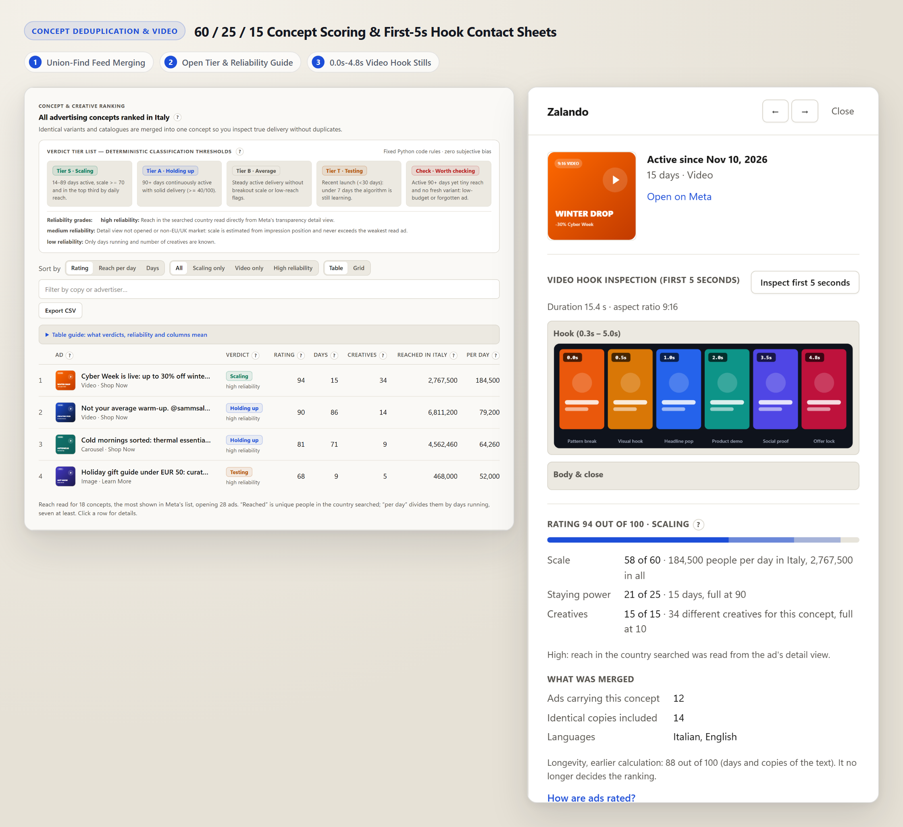
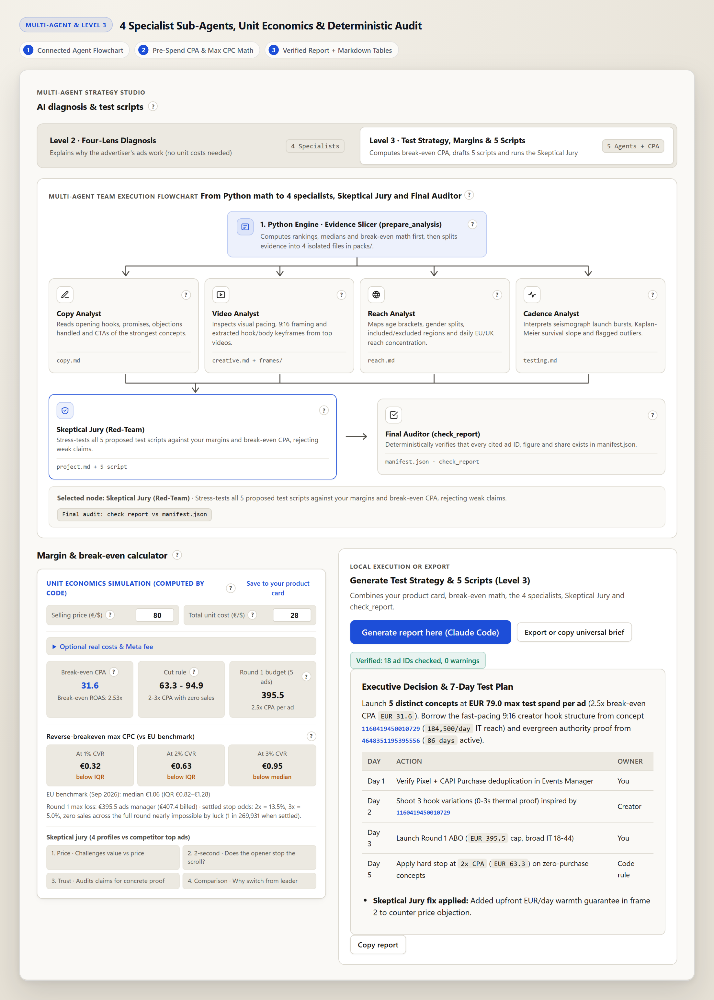
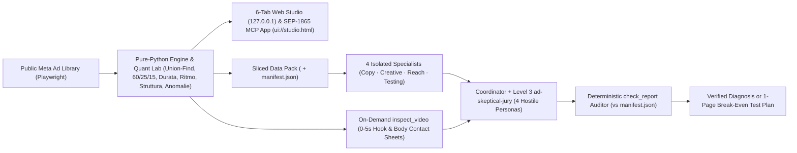
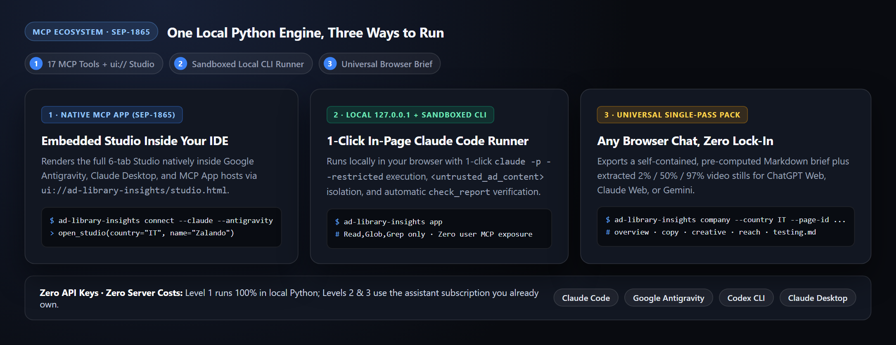

<div align="center">

# Ad Library Insights

**Competitive ad intelligence that runs an entire quantitative lab in pure Python — before an AI ever sees a word.**

[](https://github.com/KlausZanaj/ad_library_insights/stargazers)
[](https://github.com/KlausZanaj/ad_library_insights/actions/workflows/ci.yml)
[](pyproject.toml)
[](pyproject.toml)
[](#tests)
[](#connect-in-one-command-mcp-app--skills)
[](LICENSE)

<p>
  <a href="#quick-start-60-seconds">Quick Start</a> ·
  <a href="#1-two-companies-head-to-head--100-python-zero-ai">Head-to-Head Compare</a> ·
  <a href="#2-the-quantitative-lab-seismology--biostatistics-in-pure-python">Quantitative Lab</a> ·
  <a href="#3-concept-deduplication-60--25--15-scoring--video-hook-stills">Video Dissection</a> ·
  <a href="#4-multi-agent-strategy-unit-economics--red-team-jury">Multi-Agent & Level 3</a> ·
  <a href="#connect-in-one-command-mcp-app--skills">MCP & Claude Code</a>
</p>

</div>

Most "AI marketing tools" scrape raw text from the public Meta Ad Library and dump it into a single prompt, hoping the model does not confuse 50 catalogue duplicates with 50 winning ads or invent break-even math.

**Ad Library Insights flips the architecture.** Everything measurable is computed deterministically on your machine in **standard-library Python** — **zero API keys, zero tokens at rest, zero paid SaaS**: deduplicating feed and translation variants via Union-Find, comparing two advertisers head-to-head across 26 objective metrics, measuring EU+UK demographic niche overlap, fitting censored Kaplan-Meier survival curves, and detecting 9-week launch spikes like a seismic array. Only when you ask for strategic synthesis does it hand isolated, `<untrusted_ad_content>`-delimited data slices to a **4-specialist sub-agent team + Red-Team Skeptical Jury** inside **Claude Code**, **Google Antigravity**, **Codex CLI**, **Claude Desktop**, or your local browser (`127.0.0.1`).

### 86-Second Product Demo

<!-- DEMO_VIDEO_URL -->



---

## Why raw Ad Library scraping misleads (and how code fixes it)

The public Meta Ad Library displays active ads as an unsorted wall of cards. Reading it directly — or feeding raw JSON to a generic LLM — fails on four predictable traps:

| Failure mode | Raw Meta Ad Library | Generic Scraper + Prompt | **Ad Library Insights** |
|---|---|---|---|
| **Catalogue & duplicate inflation** | Lists 200+ near-identical cards across ad sets, dynamic feeds and translations. | Counts 50 dynamic product cards as "50 winning ads". | **Union-Find concept merging.** Collapses identical copies, dynamic feeds, catalogues and translations (via media keys and emoji/digit skeletons) into one row per creative concept. |
| **Survivor bias ("oldest ad = winner")** | No country-level daily velocity; ended losers disappear from active view. | Sorts by start date, ranking a forgotten 400-day retargeting ad (`90/day`) above a concept scaling at `180,000/day`. | **`60 / 25 / 15` anti-bias score + Kaplan-Meier survival.** Weights searched-country daily reach (`60`), staying power (`25`), and distinct creatives (`15`), backed by active + ended cohort survival. |
| **1-day launch spikes & EU mix-ups** | Shows combined EU reach even when you sell in a single country. | Treats a 1-day launch burst or multi-country EU total as local scale. | **Country-strict reach & 7-day floor.** Rates strictly on the searched country's reach, divides by `max(days, 7)`, and caps unread estimates below the weakest read concept. |
| **Hallucinated CPA & budget math** | None. | Lets an LLM invent conversion rates, miscalculate VAT/margins and output generic slogans. | **Deterministic Python math + `check_report` audit.** Python computes net margin, break-even CPA, max CPC vs EU IQR and Poisson stop rules; `check_report` verifies every cited Ad ID and number against `manifest.json`. |

---

## 1. Two Companies Head-to-Head — 100% Python, Zero AI

Pick any two advertisers and a country. Without calling a single LLM token, **Compare Two Companies** collects both active portfolios, merges variants into distinct creative concepts, reads EU/UK delivery details on top concepts, and computes a complete **26-indicator head-to-head diagnostic**:

- **Automatic ratio highlights:** instant plain-language deltas on active footprint, weekly launch velocity, median daily reach, video share, and scaling concepts.
- **EU+UK Demographic Niche Overlap (`Pianka Index`):** builds normalized delivery vectors across `country × age_range × gender` from Meta transparency breakdowns and measures exact ecological niche overlap (`0%` disjoint to `100%` identical), isolating **shared segments** vs **segments uniquely dominated by Company A or Company B**.
- **Side-by-side creative winners & 1-click comparative brief:** inspect both companies' top-scoring concepts directly in the drawer, or copy a structured head-to-head brief if you want your assistant to propose challenger angles.



---

## 2. The Quantitative Lab: Seismology & Biostatistics in Pure Python

Every statistical model in [`src/ad_library_insights/lab/`](src/ad_library_insights/lab) is implemented from scratch in **readable Python standard library** (`0` heavy ML/vector dependencies, `0` GPU requirements) and verified across **518 offline tests**:

| Diagnostic module | Scientific discipline | Pure-Python implementation | Question it answers |
|---|---|---|---|
| **Durata** ([`lab/durata.py`](src/ad_library_insights/lab/durata.py)) | Biostatistics & Reliability Engineering | **Kaplan-Meier** product-limit estimator on active (right-censored) + ended ads, **Greenwood SE** with `95%` log-log CI, **Weibull MLE** shape `k` (`early_cut` `k < 0.85` vs `wear_out` `k > 1.15`), conditional **Lindy** survival (`+14d`, `+30d`), and **7d–90d Drop-Off Funnel**. | *"After how many days does this brand kill half of its new concepts — and do concepts die from fast kill rules or gradual creative fatigue?"* |
| **Ritmo** ([`lab/ritmo.py`](src/ad_library_insights/lab/ritmo.py)) | Seismology & Statistical Process Control | **9-week STA/LTA launch seismograph** (1-week short-term vs 8-week long-term baseline + exact binomial `p`-value), bivariate **Page CUSUM** changepoint detection on format mix, and **Little's Law** (`L = λW`) portfolio equilibrium. | *"Is this week's creative burst a statistically real campaign push (`>= 2.5x`, `p < 0.05`), and when exactly did they pivot from static images to 9:16 video?"* |
| **Su cosa si regge** ([`lab/struttura.py`](src/ad_library_insights/lab/struttura.py)) | Information Theory & Ecology | **HHI**, effective `N` and **Gini** reach concentration; **`zlib` raw DEFLATE Normalized Compression Distance (NCD)** for parameter-free copy clustering; **Shannon** format/domain entropy; **Pianka** overlap; **Jensen-Shannon** audience drift across saved snapshots. | *"Does 80% of their reach depend on two hero concepts, how many genuinely distinct copy angles exist, and did their demographic targeting shift since last week?"* |
| **Annunci fuori schema** ([`lab/anomalie.py`](src/ad_library_insights/lab/anomalie.py)) | Deterministic Outlier Detection | Rule-based contradiction scanner across age, daily reach, creative count, and copy length (`fast_spike`, `long_live_low_reach`, `heavy_variants_short_life`). | *"Which single ad breaks the account's own pattern — e.g., a 5-day launch already beating the account's daily reach median by 10x, or a quiet 90-day retargeting workhorse?"* |


---

## 3. Concept Deduplication, `60 / 25 / 15` Scoring & Video Hook Stills

Instead of drowning you in duplicate ad-set cards, **Tab 2 (`Ads & Video`)** surfaces one clean row per creative concept with an always-visible **Tier List & Reliability Guide**:

1. **Scale (`0–60 pts`):** unique people reached per day in the searched country (`reach_total / max(days, 7)`), mapped onto a base-1000 logarithmic scale relative to the strongest concept in the search.
2. **Staying Power (`0–25 pts`):** days the concept has been running since its earliest merged card, reaching full points at `90 days` (`HORIZON_DAYS`). Ads under `7 days` are flagged `too recent to judge`.
3. **Creative Investment (`0–15 pts`):** distinct videos or images produced to carry that same concept, reaching full points at `10 creatives` (dynamic catalogues count as `1`).
4. **On-Demand Video Hook Inspection (`inspect_video`):** click any video concept in the Ad Inspector Drawer (or call `inspect_video(ad_id)` via MCP/CLI) to extract **hook-first timestamped contact sheets** — **`hook_sheet.jpg`** (`0.0s, 0.5s, 1.0s, 2.0s, 3.5s, 4.8s`) and **`body_sheet.jpg`** — plus exact aspect ratio, duration, and `<untrusted_ad_content>` safety boundaries without CORS issues (`50 MB` cap, automatic `.mp4` cleanup). *(Optional local offline Whisper speech transcription via `pip install -e ".[video]"` is experimental — verified offline with mocks.)*



---

## 4. Multi-Agent Strategy, Unit Economics & Red-Team Jury

Ad Library Insights separates **what code knows** from **what an AI interprets** across three progressive operating levels:

| Level | What runs | Cost & privacy | Output |
|---|---|---|---|
| **Level 1 · Market Map & Quant Lab** | Pure local Python (`rating`, `Durata`, `Ritmo`, `Struttura`, `Anomalie`, `Compare`, `What changed`). | **Free · Zero AI · 100% local** | Interactive 6-tab Studio, 38-column CSV, Markdown summary. |
| **Level 2 · Four-Lens Diagnosis** | Slices verified data into 5 isolated files (`overview.md`, `copy.md`, `creative.md` + stills, `reach.md`, `testing.md`) for **4 parallel specialist sub-agents** (`ad-copy`, `ad-creative`, `ad-reach`, `ad-testing`). | **Your own AI assistant** (no external API keys) | Evidence-graded diagnosis citing exact Ad IDs, cross-checked across lenses and audited by `check_report`. |
| **Level 3 · Test Strategy & Break-Even Plan** | Runs deterministic **Test before spending (`Prova prima di spendere`)** unit economics, drafts **5 challenger scripts**, attacks them with **`ad-skeptical-jury`**, and audits every number via **`check_report`**. | **Your own AI assistant + local product card** | Executive 1-page decision plan, Pixel/CAPI gate, 5 red-teamed ad scripts, ABO test budget, and 7-day calendar. |

### Built-in defenses against AI failure modes
- **Pre-computed unit economics (never LLM arithmetic):** Python computes net margin after VAT, shipping, payment fees, return rate, and Italy's `+3%` Meta regulatory fee; **reverse-breakeven max CPC** at `1% / 2% / 3%` store CVR benchmarked against EU paid-social CPC IQR (`EUR 0.82–1.28`); `2x–3x` CPA stop rules; and **Poisson zero-purchase probability** across the entire test round.
- **Skeptical Red-Team Jury (`ad-skeptical-jury`):** critiques all 5 proposed ad concepts through four hostile buyer lenses (*Price skeptic*, *2-second scroller*, *Proof doubter*, *Category loyalist*) side-by-side against the competitor's real top ads — with an explicit `No blocker — ready to test` escape valve so it never invents filler criticism.
- **Prompt-injection sandboxing:** every competitor text excerpt in `copy.md`, `creative.md`, and `brief.md` is isolated inside `<untrusted_ad_content>` tags (neutralizing spoofed closing tags). When launched in-page via **1-Click Claude Code**, `ai_runner.py` invokes `claude -p` with `--tools Read,Glob,Grep --strict-mcp-config --disallowedTools mcp__*` plus `--restricted --permission-prompts none --no-session-persistence` (automatically probed via `claude --help`), confining file reads to the pack folder and blocking Bash and user MCP servers.
- **Deterministic post-generation audit (`check_report`):** scans the generated Markdown report against `manifest.json` to flag unknown Ad IDs, `<7d` ads cited as proven winners without caveat, drifted unit-economics figures, or forbidden competitor spend/ROAS claims.



<details>
<summary><strong>View Pre-Collection Token Estimate & Universal Brief Export Screens</strong></summary>
<br>

Before opening detail pages for Level 2 or Level 3, the Studio shows the exact concept ceiling, image count, and token band:


</details>

---

## System Architecture



A complete real-world output pack is committed in [`examples/kingshot-it-2026-11-14/`](examples/kingshot-it-2026-11-14) ([competitor analysis](examples/kingshot-it-2026-11-14/analisi.md), [one-page test plan](examples/kingshot-it-2026-11-14/piano.md), [source data pack](examples/kingshot-it-2026-11-14/pacchetto)), continuously verified by [`tests/test_examples.py`](tests/test_examples.py) so every figure and Ad ID matches the underlying source files.

---

## Quick Start (60 Seconds)

Requires **Python 3.10+**. Clone the repository and install locally:

```bash
git clone https://github.com/KlausZanaj/ad_library_insights.git
cd ad_library_insights
```

**Windows (PowerShell)** — or simply double-click **`avvia.bat`** on first run:

```powershell
py -m venv .venv
.venv\Scripts\Activate.ps1
pip install -e .
python -m playwright install chromium
ad-library-insights app
```

**macOS / Linux:**

```bash
python3 -m venv .venv
source .venv/bin/activate
pip install -e .
python -m playwright install chromium
ad-library-insights app
```

*(Optional — experimental local Whisper speech transcription for `inspect_video`: `pip install -e ".[video]"` and `ad-library-insights video-setup --model base`.)*

---

## Connect in One Command (MCP App + Skills)



Register the **17-tool MCP server**, the **`ui://ad-library-insights/studio.html` interactive MCP App**, all **6 skills**, and **5 Claude Code specialist sub-agents** in one command:

```bash
ad-library-insights connect --claude --antigravity
```

- **Inside Google Antigravity / Claude Desktop / MCP App hosts:** ask *"Open Ad Library Studio"* or *"Analyze Zalando in Italy"* — `open_studio`, `analyze_company`, `search_ads`, and `compare_companies` attach `meta.ui` so the interactive 6-tab Studio renders directly inside your assistant pane.
- **Inside Claude Code CLI:** ask *"Run a Level 3 competitor plan on Zalando in IT"* — the coordinator runs `estimate_consumption` -> `prepare_analysis` -> spawns the 4 `model: sonnet` analysts in parallel -> runs `ad-skeptical-jury` -> verifies the final report with `check_report`.
- **Inside `127.0.0.1` Web Studio:** click **Generate report here (Claude Code)** in Tab 6 for 1-click sandboxed execution, or **Export universal brief** to paste into ChatGPT Web, Claude Web, or Gemini.

<details>
<summary><strong>Manual MCP Configuration (Claude Code, Google Antigravity, Codex CLI, Claude Desktop)</strong></summary>
<br>

**Claude Code CLI:**

```bash
claude mcp add ad-library-insights --scope user -- /absolute/path/.venv/bin/python -m ad_library_insights
```
*(On Windows use `C:\absolute\path\.venv\Scripts\python.exe`; copy `skills/*` to `~/.claude/skills/` and `.claude/agents/*` to `~/.claude/agents/`.)*

**Google Antigravity (`~/.gemini/config/mcp_config.json` + `~/.gemini/config/skills/`):**

```json
{
  "mcpServers": {
    "ad-library-insights": {
      "command": "C:\\absolute\\path\\.venv\\Scripts\\python.exe",
      "args": ["-m", "ad_library_insights"]
    }
  }
}
```

**ChatGPT Codex CLI:**

```bash
codex mcp add ad-library-insights -- /absolute/path/.venv/bin/python -m ad_library_insights
```

**Claude Desktop (`claude_desktop_config.json`):** same `mcpServers` JSON block as above.

</details>

<details>
<summary><strong>Full Reference: 17 MCP Tools, 6 Skills, 5 Sub-Agents & CLI Commands</strong></summary>
<br>

### Included Skills & Sub-Agents

| Skill / Agent | Role |
|---|---|
| `ad-library-research` | Market or advertiser concept mapping with rule-based hook, promise, proof, and CTA breakdown. |
| `competitor-analysis` | **Level 2 Coordinator:** dispatches 4 isolated `model: sonnet` analysts (`ad-copy-analyst`, `ad-creative-analyst`, `ad-reach-analyst`, `ad-testing-analyst`), cross-checks hypotheses, and runs `check_report`. |
| `competitor-plan` | **Level 3 Coordinator:** diagnoses your saved product card, enforces Pixel/CAPI verification, integrates unit economics, drafts 5 concepts, runs `ad-skeptical-jury`, and audits via `check_report`. |
| `ad-skeptical-jury` | **5th Sub-Agent (Red-Team):** critiques draft concepts across 4 buyer personas against real competitor winners (or clears strong drafts with `No blocker — ready to test`). |
| `inspect-video` | Single-ad video breakdown: hook-first contact sheets (`hook_sheet.jpg`, `body_sheet.jpg`), aspect ratio, duration, `<untrusted_ad_content>` rules, and optional experimental Whisper transcription. |
| `breakeven-cpa-check` | Computes net margin, break-even CPA, and `2–3x` zero-sale cut lists from unit economics or Ads Manager CSV exports. |
| `weekly-competitor-report` | Recurring watchlist diff across saved snapshots: new, stopped, and edited ads plus cohort survival, `Ritmo`, and Jensen-Shannon audience drift. |

### MCP Tools (`17`)

| Tool | Purpose |
|---|---|
| `open_studio(country, name, page_id, query, deep_ads, open_browser)` | Opens the interactive 6-tab **Ad Library Studio** (`ui://ad-library-insights/studio.html`) inside MCP App hosts or launches `127.0.0.1`. |
| `search_ads(country, query, advertiser, ..., deep_ads)` | Ranked concepts for a keyword and/or advertiser (`meta.ui` inline Studio). |
| `find_advertiser_pages(name, country)` | Candidate advertiser pages sorted by follower count with suggested match. |
| `analyze_company(country, page_id \| name, deep_ads, frames)` | Full active portfolio ranked one-per-concept with `Ritmo`, `Su cosa si regge`, and `Annunci fuori schema` (`meta.ui` inline Studio). |
| `compare_companies(country, page_id_a, page_id_b, deep_ads)` | Side-by-side comparison across 26 indicators plus EU+UK `Pianka` demographic overlap (`meta.ui` Studio). |
| `what_changed(country, query \| page_id)` | Diffs the latest two local snapshots (new, stopped, modified ads, survival, `Ritmo`, Jensen-Shannon drift). |
| `estimate_consumption(level, ads, frames)` | Upfront ceiling on detail pages, stills, tokens, and runtime before Level 2/3 collection. |
| `prepare_analysis(country, level, page_id \| query, ads, frames)` | Writes the isolated specialist pack (`overview.md`, `copy.md`, `creative.md`, `reach.md`, `testing.md`, `project.md`, `brief.md`, `frames/`, `manifest.json`). |
| `get_project()` / `save_project(...)` | Reads or validates and persists your local Level 3 product & cost card. |
| `analyze_top_ads(country, query, advertiser, top_n)` | Deterministic hook, promise, proof, and CTA extraction on top concepts. |
| `export_report(country, output_dir, query, advertiser, top_n, formats)` | Exports standalone Markdown reports and 38-column CSV tables. |
| `scrape_library_url(url, ...)` | Runs the deduplication and scoring pipeline on any pre-filtered Meta Ad Library URL. |
| `check_breakeven_cpa(price, product_cost, ..., ads \| csv_path)` | Break-even CPA calculator and Ads Manager CSV kill-list auditor. |
| `check_report(pack_folder, report_text, report_path)` | Deterministic post-generation audit of Markdown reports against `manifest.json`. |
| `inspect_video(ad_id, pack_folder, transcribe, ...)` | Single-video hook/body contact-sheet extractor (`hook_sheet.jpg`, `body_sheet.jpg`) and experimental offline Whisper transcription. |
| `app_studio_action(action, payload)` | App-only MCP backend bridge (`visibility: ["app"]`) powering interactive actions inside `ui://ad-library-insights/studio.html`. |

### Command-Line Interface

```bash
ad-library-insights connect --claude --antigravity
ad-library-insights app --port 8765
ad-library-insights pages --country IT --name "<advertiser>"
ad-library-insights company --country IT --page-id <page_id> --deep 20 --out reports
ad-library-insights report --country DE --query "<keyword>" --top 10 --out reports
ad-library-insights breakeven --price 80 --product-cost 28 --shipping-cost 5 --fee-pct 3 --csv export.csv
ad-library-insights video --ad-id <ad_id>
```

</details>

---

## Known Limits & Engineering Honesty

- **No spend and no sales.** Meta does not publish commercial ad spend or conversions. Longevity, creative count, and daily reach are strong delivery proxies — never proof of positive ROAS.
- **Reach is published only for EU and UK delivery.** Outside the EU/UK, the engine states plainly that reach is unpublished and scores scale from impression rank.
- **Concept reach is a lower bound on multi-card concepts.** Up to 3 cards per concept are opened and summed, and every figure states `k of m ads read`.
- **Durata requires `>= 90%` cohort coverage (up to ~400 ads).** For mega-accounts exceeding the scroll window — or when Meta omits total ad counts — **Durata** refuses to extrapolate and reports *not measurable* rather than plotting a biased curve, while preserving active-portfolio **Ritmo**.
- **Optional `inspect_video` speech transcription is experimental.** Hook/body contact sheets and live Meta video extraction are verified live; optional local Whisper transcription (`pip install -e ".[video]"`) is currently verified offline with mocks.
- **Web renderer, not a Graph API token.** Layout changes on Meta's public page can require parser updates; rate-limited responses report `blocked` after retries rather than a false "0 ads".

See [`docs/valutazione.md`](docs/valutazione.md), [`docs/riepilogo-prima-e-dopo.md`](docs/riepilogo-prima-e-dopo.md), and [`docs/controllo-qualita.md`](docs/controllo-qualita.md) for methodology proofs and edge-case audits.

---

## Tests

```bash
pip install -e ".[dev]"
python -m pytest
```

The **518-test suite** (unit, statistical invariants, security/sandboxing, MCP protocol, and headless Playwright UI) runs 100% offline against recorded fixtures in `tests/fixtures/` with a deterministic fake clock.

---

## Support the Project

If **Ad Library Insights** saved you hours of manual Ad Library scrolling or inspired how you structure MCP + deterministic analytics workflows, consider giving it a ⭐ on GitHub — it directly helps others discover the project!

<a href="https://github.com/KlausZanaj/ad_library_insights/stargazers">
  
</a>

## License

MIT License — Copyright (c) 2026 Klaus Zanaj. See [LICENSE](LICENSE).
