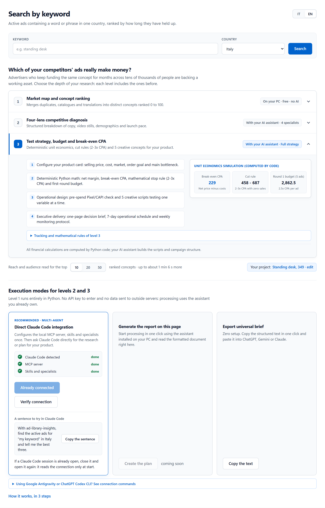
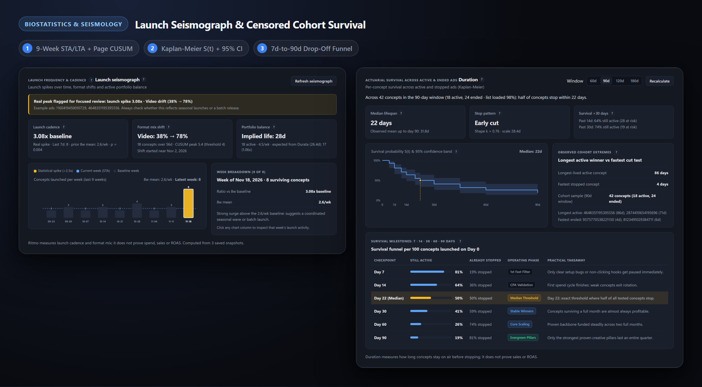
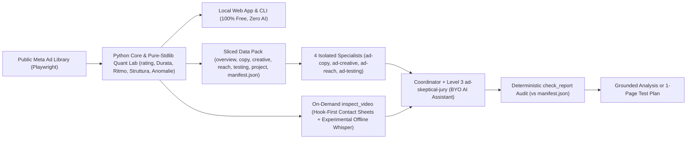
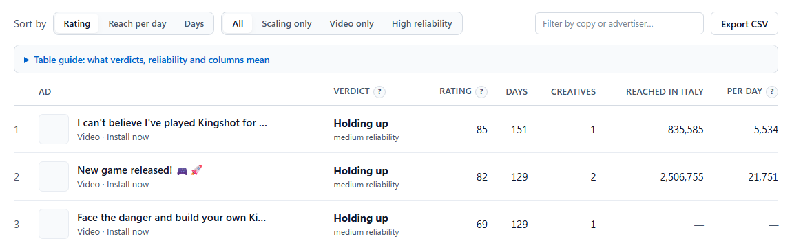

# Ad Library Insights

**Turn the public Meta Ad Library into deterministic competitive intelligence, quantitative survival diagnostics, and break-even test plans on your own machine — zero API keys, zero tokens at rest, zero paid tools.**

[](pyproject.toml)
[](LICENSE)
[](#tests)
[](#connect-to-claude-code-google-antigravity-codex-cli-or-claude-desktop)

Ad Library Insights reads the public Meta Ad Library and runs an entire **pure-Python quantitative pipeline** before an LLM ever sees a byte: merging duplicate feeds and translations into distinct creative concepts, computing Kaplan-Meier cohort survival, detecting launch bursts and format shifts, slicing verified data packs into isolated specialist views, stress-testing ad drafts with an independent red-team jury, auditing the final draft deterministically, and inspecting individual video ads on demand.

It runs inside **MCP App hosts** (`ui://ad-library-insights/studio.html` in Google Antigravity, Claude Desktop, and compatible clients), as a **local 5-tab Studio web app** (`127.0.0.1` with 1-click Claude Code execution), as a **command-line tool**, and as a standard **MCP server** (17 tools, 6 skills, 5 sub-agents). Everything runs locally using your own AI assistant (Claude Code, Google Antigravity, Codex CLI, Claude Desktop, or any browser chat).

---

## What makes this different

| Pillar | What it does | How it stays grounded |
|---|---|---|
| **1. Zero-AI Quant Engine (Level 1)** | Deduplicates copies/catalogues/translations via Union-Find, scores concepts 60/25/15, and runs **Durata** (Kaplan-Meier survival, Greenwood 95% CI, Weibull failure regime, Lindy), **Ritmo** (9-week STA/LTA launch seismograph, bivariate Page CUSUM format drift, Little's Law `L = λW`), **Su cosa si regge** (HHI/Gini reach concentration, `zlib` NCD copy families, Shannon entropy, Pianka overlap, Jensen-Shannon audience drift), and **Annunci fuori schema** contradictions. | 100% deterministic Python standard library (`src/ad_library_insights/lab/`). Free, offline-testable, zero LLM math. |
| **2. Isolated Four-Lens Diagnosis (Level 2)** | Splits the research into 5 focused files (`overview.md`, `copy.md`, `creative.md` + 2%/50%/97% stills, `reach.md`, `testing.md`). Where supported, 4 specialist sub-agents run in parallel on `model: sonnet` so the stronger coordinator model synthesizes cross-lens evidence cleanly. | Strict ad-ID grounding, single `Strength` scale, and at most one neutral follow-up on unresolved core contradictions. |
| **3. Unit Economics & Red-Team Jury (Level 3)** | Enforces a pre-spend Pixel/CAPI verification gate, computes **Test before spending (`Prova prima di spendere`)** (net margin after VAT/shipping/fees/returns + IT `+3%` Meta auction fee, reverse-breakeven max CPC vs EU benchmark IQR, Poisson zero-sales stop odds), drafts 5 ad concepts, stress-tests them with `ad-skeptical-jury`, and runs `check_report` before delivery. | Code computes every budget, CPA, ROAS and cut threshold; `ad-skeptical-jury` uses a `No blocker — ready to test` escape valve instead of inventing filler flaws; `check_report` catches IDs or claims not backed by `manifest.json`. |
| **4. On-Demand Video Inspection (`inspect_video`)** | Extracts hook-first timestamps into two labeled contact sheets (`hook_sheet.jpg`, `body_sheet.jpg`) plus individual frames, detects exact aspect ratio and duration, and optionally transcribes speech offline via `pip install -e ".[video]"`. | CORS-free `video.screenshot()` capture, strict ASCII `ad_id` and Meta CDN validation (`50 MB` cap, `.mp4` cleanup in `finally`), `<untrusted_ad_content>` delimiters. **Local Whisper transcription is experimental (verified with offline mocks, not yet tested live).** |





---

## Why pure math before AI (The Quantitative Lab)

Raw Meta Ad Library scraping breaks on survivor bias, launch spikes, duplicated copy feeds, and LLM hallucination. Every quantitative signal below is computed locally in deterministic Python (`0` external ML/vector dependencies) before any AI sees the data:

| Ad Library failure mode | Field | Deterministic implementation (pure Python stdlib) | What it prevents |
|---|---|---|---|
| **Right-censored active ads (survivor bias)** | Biostatistics / Survival analysis | [`lab/durata.py`](src/ad_library_insights/lab/durata.py): Kaplan-Meier with Greenwood SE & 95% log-log CI, Weibull MLE shape `k` (`early_cut` vs `fatigue`), conditional Lindy survival | Stops treating the oldest active ad as a winner when early-cut losers are hidden. |
| **Single-ad launch noise & gradual format shifts** | Seismology & statistical process control | [`lab/ritmo.py`](src/ad_library_insights/lab/ritmo.py): STA/LTA launch cadence (1w vs 8w exact binomial test), bivariate Page CUSUM on format share, Little's Law (`L = λW`) | Flags real launch spikes and sustained format pivots while ignoring isolated launches. |
| **Copy duplication & demographic drift without embeddings** | Information theory & ecology | [`lab/struttura.py`](src/ad_library_insights/lab/struttura.py): `zlib` raw DEFLATE Normalized Compression Distance (NCD), HHI/Gini reach concentration, Shannon diversity, Pianka niche overlap, Jensen-Shannon drift | Quantifies concentration, copy families and audience overlap/drift locally with zero GPU or vector DB. |
| **LLM confirmation bias & hallucinated ad math** | Intelligence analysis (ACH & red-teaming) | [`skills/`](skills) + [`.claude/agents/`](.claude/agents) + [`lab/audit.py`](src/ad_library_insights/lab/audit.py): 4 isolated specialist slices, Analysis of Competing Hypotheses, independent Level 3 `ad-skeptical-jury`, deterministic `check_report` | Separates evidence collection from synthesis and catches ungrounded IDs, impossible claims or drifted budget math before delivery. |

Every formula lives in readable standard-library Python under [`src/ad_library_insights/lab/`](src/ad_library_insights/lab) and is verified by the 504-test offline suite — zero black-box scores.

---

## System architecture



### Verified real-world output

A complete end-to-end example built from a saved search lives in [`examples/kingshot-it-2026-11-14/`](examples/kingshot-it-2026-11-14):
- [Competitor analysis](examples/kingshot-it-2026-11-14/analisi.md)
- [One-page test plan](examples/kingshot-it-2026-11-14/piano.md)
- [Source data pack](examples/kingshot-it-2026-11-14/pacchetto)

[`tests/test_examples.py`](tests/test_examples.py) verifies automatically that every figure and ad ID cited in both reports exists in the source pack.

---

## Why this exists

The public Ad Library shows every active ad as an unsorted wall of cards, hiding what a performance marketer actually needs to evaluate spend and creative longevity.

| Problem | Raw Meta Ad Library | Plain Scrapers + Generic Prompt | **Ad Library Insights** |
|---|---|---|---|
| **Duplicate & catalogue noise** | Lists 200+ near-identical cards across ad sets, dynamic variations, product feeds and translations. | Counts 50 catalogue items or copies as "50 winning ads", inflating copy reuse. | **One row per concept.** Identical copies, dynamic versions, catalogue feeds and translations (via Union-Find on media keys and emoji/digit skeletons) merge into the distinct creative ideas behind the wall of cards. |
| **"Oldest ad = winner" trap** | No ranking by daily delivery in a single country. | Sorts by start date, putting a forgotten 500-day retargeting ad (90 people/day) above an ad scaling at 100k+ people/day. | **60 / 25 / 15 scoring.** Weights daily reach in the searched country (60 pts), staying power up to 90 days (25 pts) and distinct creatives up to 10 (15 pts). |
| **1-day launch spikes & EU vs country mix-ups** | Highlights total EU reach even when you sell in one country. | Treats a 1-day launch spike or EU-wide delivery as local scale. | **Country-specific & 7-day floor.** Rates strictly on the searched country's reach, divides by at least 7 days (`MIN_RATE_DAYS`), and never lets an unread ad outscore a read one. |
| **Hallucinated math in AI test plans** | None. | Dumps raw JSON into one prompt; the model invents budgets, miscalculates CPA/ROAS and writes generic advice. | **Deterministic Python math + isolated specialists.** Code computes margin, break-even CPA, max CPC, cut rules and test budgets; specialists cross-check evidence citing every ad ID, audited by `check_report`. |

---

## Three operating levels & UI walkthrough

| Level | What you get | What it uses |
|---|---|---|
| **Level 1 · Market Map & Concept Ranking** | Ranked creative concepts (0–100), interactive table guide, days on air, country reach, audience demographics, **Durata** cohort survival, **Ritmo** 9-week launch & CUSUM drift, **Su cosa si regge** concentration/NCD/Pianka/JS drift, and **Annunci fuori schema** contradictions. | **Nothing:** 100% local Python code, free, no AI. |
| **Level 2 · Four-Lens Competitive Diagnosis** | A sliced data pack (`overview.md`, `copy.md`, `creative.md` + 2%/50%/97% stills, `reach.md`, `testing.md`) and a structured brief explaining *why* top concepts hold up. | Your own AI assistant (Claude Code, Antigravity, Codex CLI, ChatGPT or Claude). |
| **Level 3 · Test Strategy & Break-Even CPA** | Pre-spend Pixel/CAPI check, **Test before spending (`Prova prima di spendere`)** with optional real costs, reverse-breakeven max CPC vs EU benchmark, Poisson zero-sales odds, five ad concepts stress-tested by `ad-skeptical-jury`, and a one-page plan audited by `check_report`. | Your own AI assistant + your saved local product card. |

Before starting any Level 2 or Level 3 collection, the app displays the exact number of concepts to open, the detail-view ceiling, and a token/image estimate, waiting for confirmation.





---

## Other built-in capabilities

- **Four research modes:**
  1. **Search by keyword** in any country (with automatic off-topic suggestions plus **Su cosa si regge** & **Annunci fuori schema** sample breakdown).
  2. **Analyse a company** from its verified page, with on-demand **Durata** cohort survival (60/90/120/180-day Kaplan-Meier curve, Weibull failure regime & Lindy survival) and **Ritmo** 9-week seismograph.
  3. **Compare two companies** across 26 objective indicators plus **EU+UK audience overlap (Pianka index)** over `country × age × gender`.
  4. **What changed & cohort survival:** every search is saved locally; from the second search of the same company, it lists new, stopped and modified ads, computes **survival rate by age cohort**, tracks **Ritmo** launch/format alerts, and measures **Audience drift (Jensen-Shannon distance)** across snapshots.
- **5-Tab Interactive Studio (`overview`, `pulse`, `structure`, `ads`, `strategy`):** collapsible summary search bar (`/` shortcut, `1–5` and `← →` keyboard navigation), Quick-Reopen history chips, Table & Visual Cards Grid toggle, Prev/Next Ad Inspector with on-demand **first-5-seconds Video Hook inspection**, and an embedded **MCP App (`ui://ad-library-insights/studio.html`)** view.
- **Interactive Table Guide, Auto Summary & 6-Tab Tutorial:** automatic **In breve** summary banner, inline **`?`** contextual popovers, 6-tab **Tutorial & KPI** modal, and expandable **Table guide** explaining every Verdict and Reliability grade.
- **Break-even CPA checker & CSV cut list:** computes net margin, break-even CPA, max CPC at 1%/2%/3% CVR and flags zero-sale over-spenders directly from an Ads Manager CSV export.
- **Bilingual & dual-theme responsive UI:** Italian and English sticky toggle, smooth Light and Deep Blue Dark theme transitions, and mobile-safe horizontal table scrolling with viewport-clamped popovers.

---

## Installation

Requires Python 3.10 or newer. Clone or download the repository and open the project folder:

```bash
git clone https://github.com/KlausZanaj/ad_library_insights.git
cd ad_library_insights
```

**Windows (PowerShell)**

```powershell
py -m venv .venv
.venv\Scripts\Activate.ps1
pip install -e .
python -m playwright install chromium
```

**macOS / Linux**

```bash
python3 -m venv .venv
source .venv/bin/activate
pip install -e .
python -m playwright install chromium
```

If PowerShell blocks activation scripts, run `Set-ExecutionPolicy -Scope CurrentUser RemoteSigned` once, or invoke `.venv\Scripts\python.exe -m ad_library_insights` directly.

*(Optional — **experimental** offline speech transcription for `inspect_video`: install the `.[video]` extra and pre-download a local Whisper model once in your terminal so MCP calls never wait on model downloads. Verified offline with mocks, not yet tested live on a real video:)*

```bash
pip install -e ".[video]"
ad-library-insights video-setup --model base
```

---

## Quick start: Web App (`avvia.bat`)

On Windows, double-click **`avvia.bat`**. On first launch it creates the virtual environment and installs dependencies; afterwards it opens the local web app directly in your browser. On any OS with the virtual environment active:

```bash
ad-library-insights app
```

1. **Pick a mode and depth level (1, 2 or 3).** Clicking any level expands its workflow and live simulator; once loaded, results open in the **5-tab Studio** while the search bar collapses cleanly at the top.
2. **Choose how many concepts to read in depth (10, 20 or 50).** Opens the most shown ad of each concept first, then second/third ads up to a ceiling of two ads opened per concept requested.
3. **Run, connect or export for Levels 2 and 3:**
   - **1-Click In-Page AI Execution (Claude Code):** click **Generate report here (Claude Code)** in Tab 5 (`Strategy & AI`) to pipe the prepared brief via `stdin` to local `claude -p`, audit it deterministically via `check_report`, and click any cited Ad ID in the rendered report to open its inspector drawer.
   - **1-Click Assistant Setup:** click **Connect now** on the page — or run `ad-library-insights connect --claude --antigravity` — to configure the MCP server, 6 skills, and 5 sub-agents.
   - **Universal 1-Click Copy:** click **Copy for your assistant** to copy a self-contained single-pass brief for ChatGPT, Claude Web or Gemini, and **Open stills folder** to attach extracted video frames.


---

## Connect to Claude Code, Google Antigravity, Codex CLI or Claude Desktop

No external LLM APIs or keys are ever called by the app. Four integration layers are supported:
- **Interactive MCP App Studio (`ui://ad-library-insights/studio.html`):** renders the full 5-tab Studio natively inside compatible MCP hosts (Google Antigravity Side Pane / Global Sidebar / inline results, Claude Desktop, ChatGPT MCP Apps) via `open_studio`, `search_ads`, `analyze_company`, and `compare_companies`.
- **Universal Web App Copy (`brief.md`) & Local 1-Click Runner:** one-click single-pass brief for any browser chat (ChatGPT, Gemini Web, Claude Web), or direct `claude -p` execution inside Tab 5 on `127.0.0.1`.
- **Standard MCP server (`17` tools: `16` model-visible + `app_studio_action`) + 6 [`skills/`](skills):** model-agnostic integration for Claude Code, Google Antigravity, Codex CLI, Cursor and Claude Desktop.
- **Dedicated Claude Code sub-agents ([`.claude/agents/`](.claude/agents)):** isolated `model: sonnet` execution for the 4 research analysts and Level 3 `ad-skeptical-jury` runs natively in Claude Code; on all other clients, the same checklists run in a single pass via `brief.md`.

### 1. One-Command Setup (`connect`)

Run once to install skills and configure Claude Code or Google Antigravity automatically:

```bash
ad-library-insights connect --claude --antigravity
```

Or click **Connect now** in the web app, or register Claude Code manually:

```bash
claude mcp add ad-library-insights --scope user -- /absolute/path/.venv/bin/python -m ad_library_insights
```

*(On Windows use `C:\absolute\path\.venv\Scripts\python.exe`).* Copy the folders in `skills/` to `~/.claude/skills/` and the files in `.claude/agents/` to `~/.claude/agents/`.

### 2. Google Antigravity

`ad-library-insights connect --antigravity` writes `~/.gemini/config/mcp_config.json` and copies `skills/` to `~/.gemini/config/skills/` automatically. Manual entry:

```json
{
  "mcpServers": {
    "ad-library-insights": {
      "command": "C:\\absolute\\path\\.venv\\Scripts\\python.exe",
      "args": ["-m", "ad_library_insights"]
    }
  }
}
```

Or copy the folders inside `skills/` into `.agents/skills/` inside your workspace.

### 3. ChatGPT Codex CLI

Register the MCP server and copy `skills/` into `~/.codex/skills/`:

```bash
codex mcp add ad-library-insights -- /absolute/path/.venv/bin/python -m ad_library_insights
```

### 4. Claude Desktop (`claude_desktop_config.json`)

```json
{
  "mcpServers": {
    "ad-library-insights": {
      "command": "C:\\absolute\\path\\.venv\\Scripts\\python.exe",
      "args": ["-m", "ad_library_insights"]
    }
  }
}
```

### Included Skills & Specialist Sub-Agents

| Skill / Agent | Role |
|---|---|
| `ad-library-research` | Map a market or advertiser and break down the hooks, promises, proof and CTAs of the top concepts. |
| `competitor-analysis` | **Level 2 Coordinator:** runs the 4 `model: sonnet` specialist sub-agents in parallel (`ad-copy-analyst`, `ad-creative-analyst`, `ad-reach-analyst`, `ad-testing-analyst`), enforces strict ad-ID grounding and optional single neutral follow-ups, and checks the draft with `check_report`. |
| `competitor-plan` | **Level 3 Coordinator:** diagnoses your product card, enforces the Pixel/CAPI tracking check, integrates `Test before spending`, drafts 5 ad concepts, stress-tests them via `ad-skeptical-jury`, and audits the final plan with `check_report`. |
| `ad-skeptical-jury` | **5th Sub-Agent (Level 3 red-team):** reads `project.md`, `overview.md` and `copy.md` in isolation to flag copy, proof or margin flaws on the 5 draft ideas — or clears solid ideas with `No blocker — ready to test`. |
| `inspect-video` | On-demand breakdown of one single video ad: hook-first contact sheets (`hook_sheet.jpg`, `body_sheet.jpg`) with timestamps, aspect ratio, duration, `<untrusted_ad_content>` boundary rules, and optional offline Whisper speech transcription (`.[video]`, experimental). |
| `breakeven-cpa-check` | Computes break-even CPA from unit economics and flags underperforming ads from an Ads Manager CSV export. |
| `weekly-competitor-report` | Tracks a fixed watchlist across saved searches and reports new, stopped and changed ads plus cohort survival and `Ritmo` launch/format alerts. |

### MCP Tools (17)

| Tool | Purpose |
|---|---|
| `open_studio(country, name, page_id, query, deep_ads, open_browser)` | Opens the interactive 5-tab **Ad Library Studio** UI resource (`ui://ad-library-insights/studio.html`) inside MCP App hosts (Side Pane, Global Sidebar, or inline) or launches the local `127.0.0.1` Studio. |
| `search_ads(country, query, advertiser, ..., deep_ads)` | Ranked concepts for a keyword and/or advertiser name (`meta.ui` opens results inline in the Studio). `deep_ads` reads reach and audience for the most shown concepts. |
| `find_advertiser_pages(name, country)` | Advertiser pages suggested by the library for a name, with followers and category. |
| `analyze_company(country, page_id \| name, deep_ads, frames)` | Every active ad of one page, ranked, with company signals, reach, audience, `Ritmo`, `Su cosa si regge` and `Annunci fuori schema` (`meta.ui` opens the 5-tab Studio inline). |
| `compare_companies(country, page_id_a, page_id_b, deep_ads)` | Two pages side by side across 26 metrics plus EU+UK `Pianka` audience overlap (`meta.ui` opens the Studio comparison view). |
| `what_changed(country, query \| page_id)` | New, stopped and changed ads since the previous search, cohort survival, `Ritmo` and Jensen-Shannon audience drift. |
| `estimate_consumption(level, ads, frames)` | Token, image and time estimate for a Level 2 or Level 3 run. |
| `prepare_analysis(country, level, page_id \| query, ads, frames)` | Collects data and writes the specialist pack (`overview.md`, `copy.md`, `creative.md`, `reach.md`, `testing.md`, `project.md`, `brief.md`, `frames/`). |
| `get_project()` / `save_project(...)` | Reads or validates and saves the local product card for Level 3. |
| `analyze_top_ads(country, query, advertiser, top_n)` | Rule-based hook, promise, proof and CTA breakdown of the top concepts. |
| `export_report(country, output_dir, query, advertiser, top_n, formats)` | Exports a Markdown brief and/or a 38-column CSV. |
| `scrape_library_url(url, ...)` | Runs the same ranking pipeline on a pre-filtered Ad Library URL. |
| `check_breakeven_cpa(price, product_cost, ..., ads \| csv_path)` | Break-even CPA calculation and cut list from unit economics. |
| `check_report(pack_folder, report_text, report_path)` | Warning-only deterministic audit of a draft report against `manifest.json`. |
| `inspect_video(ad_id, pack_folder, transcribe, ...)` | On-demand single-ad video inspection: hook-first contact sheets, aspect ratio/duration and optional offline Whisper speech transcription via `.[video]` (experimental, one `ad_id` per call). |
| `app_studio_action(action, payload)` | App-only MCP backend bridge (`visibility: ["app"]`) serving search, Durata, calculator, media and video inspection calls from the embedded `ui://` Studio without model round-trips. |

---

## Command-line usage

```bash
ad-library-insights connect --claude --antigravity
ad-library-insights report --country DE --query "<keyword>" --top 10 --out reports
ad-library-insights pages --country US --name "<advertiser>"
ad-library-insights company --country US --page-id <page id> --deep 20 --out reports
ad-library-insights breakeven --price 60 --product-cost 20 --shipping-cost 5 --fee-pct 3 --csv export.csv
ad-library-insights video --ad-id <ad id>
```

---

## How the rating works (60 / 25 / 15)

1. **One ad per concept.** Identical copies, dynamic versions, catalogue ads and translations are merged and never counted as separate creatives.
2. **Scale, up to 60 points.** People reached per day in the searched country: unique people reached divided by days on air (`7` at the least), ranked against the best ad of the search on a base-1000 log scale. Unread ads get a prudent position estimate that never exceeds the weakest read ad.
3. **Staying power, up to 25 points.** Days the concept has been on air, full at 90 days.
4. **Creative investment, up to 15 points.** Distinct videos or images carrying the same copy, full at 10 creatives (catalogues count as 1).
5. **Reliability (`high`, `medium`, `low`) & Verdict (`scaling`, `holding`, `testing`, `review`, `average`, `ended`).** Ads under 7 days are marked `too recent to judge`. `scaling` and `review` require read reach across at least 5 concepts.

See [`docs/valutazione.md`](docs/valutazione.md) and [`docs/riepilogo-prima-e-dopo.md`](docs/riepilogo-prima-e-dopo.md) for before-and-after proofs on real searches, and [`docs/controllo-qualita.md`](docs/controllo-qualita.md) for the full audit trail and hard cases.

---

## Known limits

- **No spend and no sales.** The Ad Library does not publish them. The rating is a clue about sustained delivery, not proof of profit.
- **Reach exists only for the EU and the UK.** Outside the EU and UK, the app states that reach is unpublished and rates on impression position.
- **Reach is a floor for concepts split over many ads.** Up to three ads per concept are opened and summed, and every figure states how many ads of the concept were read.
- **Standard live searches only list currently active ads.** Tracking cut rates, stopped ads, and `audience_drift` over time requires a second saved snapshot (`what_changed`), while on-demand **Durata** fetches both active and recently ended ads (60–180 days).
- **Durata requires >=90% cohort coverage (up to ~400 ads loaded).** For advertisers with many hundreds of ads in the window—or when Meta does not report the total ad count—**Durata** reports *not measurable* rather than extrapolating from a partial list.
- **Optional `inspect_video` audio transcription is experimental.** Visual contact-sheet extraction and live Meta lookups were verified live on real ads, while optional local Whisper speech transcription (`pip install -e ".[video]"`) has so far only been verified offline with mocked dependencies and has not yet been tested live.
- **It reads a web page, not an API.** Layout changes can require parser updates; when no cards are served after retries, the tool reports `blocked` rather than "no results".
- **Start dates reset on edits,** and the rule-based copy breakdown supports English, Italian, Spanish, French and German.

---

## Tests

```bash
pip install -e ".[dev]"
python -m pytest
```

The 509-test suite runs entirely offline using recorded fixtures in `tests/fixtures/`, a scripted renderer and a deterministic fake clock.

## License

MIT. See [LICENSE](LICENSE).
