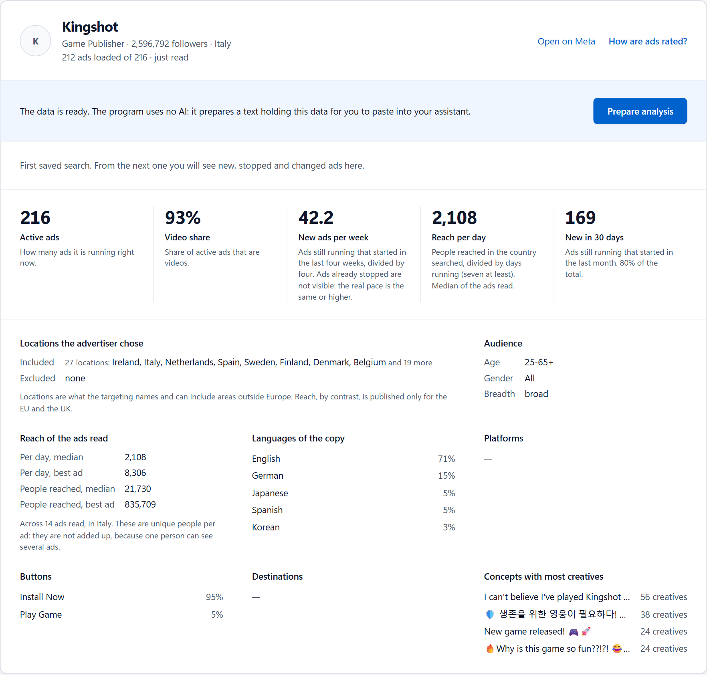
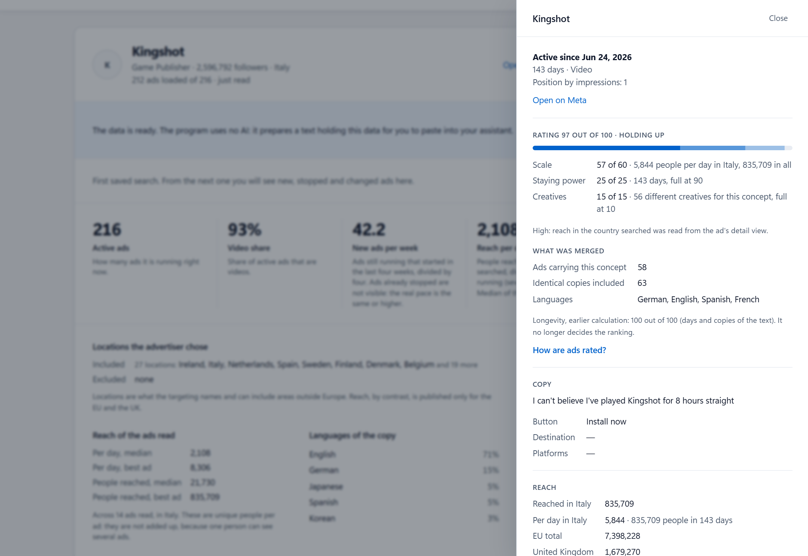
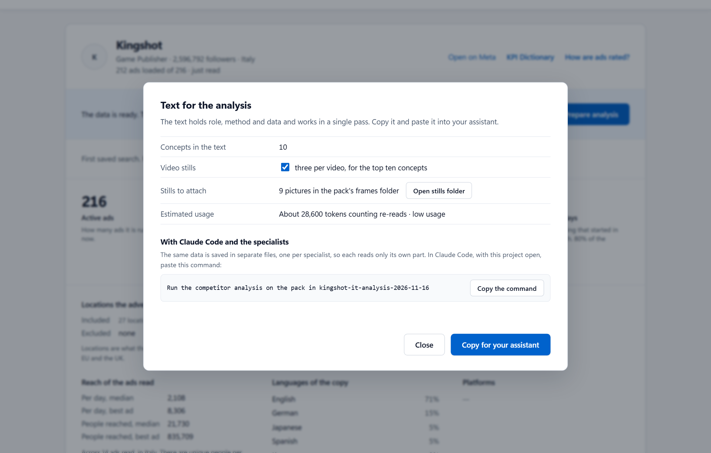

# Ad Library Insights

**See which ads a competitor really keeps funding on Meta, and why, without an account, a token or a paid tool.**

[](pyproject.toml)
[](LICENSE)
[](#tests)

Ad Library Insights reads the public Meta Ad Library and turns it into structured, verifiable competitive research: a ranked list of the creative concepts an advertiser keeps on air, how many people each one reaches per day in your target country, how its copy and video stills are built, and a deterministic data pack your own AI assistant can turn into a four-lens diagnosis or a break-even CPA test plan.

It runs as a **local web app** (`127.0.0.1`), a **command-line tool**, and a standard **MCP server** with ready-made skills and four specialist sub-agents. Everything runs on your computer.


---

## Why this exists

The public Ad Library shows every active ad as an endless wall of cards, but it hides what a media buyer actually needs to know.

| Problem | Raw Meta Ad Library | Plain Scrapers + Generic Prompt | **Ad Library Insights** |
|---|---|---|---|
| **Duplicate & catalogue noise** | Lists 200+ near-identical cards across ad sets, dynamic variations, product feeds and translations. | Counts 50 catalogue items or copies as "50 winning ads", inflating copy reuse. | **One row per concept.** Identical copies, dynamic versions, catalogue feeds and translations (via Union-Find on media keys and emoji/digit skeletons) merge into the 14 real ideas behind 212 cards. |
| **"Oldest ad = winner" trap** | No ranking by daily delivery in a single country. | Sorts by start date, putting a forgotten 500-day retargeting ad (90 people/day) at #1 above an ad scaling at 117,000 people/day. | **60 / 25 / 15 scoring.** Weights daily reach in the searched country (60 pts), staying power up to 90 days (25 pts) and distinct creatives up to 10 (15 pts). |
| **1-day launch spikes & EU vs country mix-ups** | Highlights total EU reach even when you only sell in one country. | Treats a 1-day launch spike or EU-wide delivery as local scale. | **Country-specific & 7-day floor.** Rates strictly on the searched country's reach, divides by at least 7 days (`MIN_RATE_DAYS`), and never lets an unread ad outscore a read one. |
| **Hallucinated math in AI test plans** | None. | Dumps raw JSON into one prompt; the model invents budgets, miscalculates CPA/ROAS and writes generic advice. | **Deterministic Python math + 4 Specialists.** Code computes margin, break-even CPA, 2-3x cut rules and test budgets; four isolated sub-agents cross-check evidence citing every ad ID. |

---

## Three operating levels


| Level | What you get | What it uses |
|---|---|---|
| **Level 1 · Market Map & Concept Ranking** | Ranked creative concepts (0-100), interactive table guide, days on air, country reach, audience demographics, format mix, launch pace, buttons and destinations. | **Nothing:** 100% local Python code, free, no AI. |
| **Level 2 · Four-Lens Competitive Diagnosis** | A sliced data pack (`overview.md`, `copy.md`, `creative.md` + video stills at 2%/50%/97%, `reach.md`, `testing.md`) and a ready brief to explain *why* the top concepts hold up, backed by ad ID citations. | Your own AI assistant (Claude Code, Google Antigravity, Codex, ChatGPT or Claude). |
| **Level 3 · Test Strategy & Break-Even CPA** | Pre-spend Pixel/CAPI check, deterministic unit economics (net margin, break-even CPA, 2-3x CPA cut rule, first-round budget), five single-variable ad scripts anchored to winning competitor patterns, and a one-page decision report. | Your own AI assistant + your saved local product card. |

Before starting a Level 2 or Level 3 search, the app shows the exact number of concepts to open, the ceiling of detail views, and a token/image estimate, waiting for your confirmation.


A complete real-world example produced from a saved search is in [`examples/`](examples): the [analysis](examples/kingshot-it-2026-11-14/analisi.md), the [plan](examples/kingshot-it-2026-11-14/piano.md) and the [data pack](examples/kingshot-it-2026-11-14/pacchetto) they were written from. An automated test in [`tests/test_examples.py`](tests/test_examples.py) verifies that every single figure and ad ID in both documents exists in the data pack.

---

## What else is built in

- **Four research modes**:
  1. **Search by keyword** in any country (with automatic suggestions when a wording returns mostly off-topic ads).
  2. **Analyse a company** from its verified Facebook page.
  3. **Compare two companies** side by side across 26 objective indicators (volume, launch pace, video share, copy proof, median daily reach, audience breadth, platforms and destinations).
  4. **What changed & cohort survival**: every search is saved locally; from the second search of the same company, it lists new, stopped and modified ads and computes the **survival rate by age cohort**.
- **Interactive Table Guide & In-App Step-by-Step Tutorial**: click the **Tutorial** button in the top bar for a 4-tab operating walkthrough, or expand the **Table guide** above any ranking to inspect the exact meaning of every Verdict (`Scaling`, `Holding up`, `Testing`, `Worth checking`, `Average`, `Ended`), Reliability grade (`High`, `Medium`, `Low`) and column.
- **Break-even CPA checker**: computes your break-even cost per purchase from selling price, product cost, shipping, payment fees and return rate, and flags ads from an Ads Manager CSV export that spent 2-3x break-even CPA with zero sales.
- **Bilingual & dual-theme UI**: Italian and English interface, Apple Light and Deep Blue Dark themes.





---

## Installation

Requires Python 3.10 or newer.

**Windows (PowerShell)**

```powershell
py -m venv .venv
.venv\Scripts\Activate.ps1
pip install -e .
python -m playwright install chromium
```

**macOS / Linux**

```bash
python3 -m venv .venv
source .venv/bin/activate
pip install -e .
python -m playwright install chromium
```

If PowerShell refuses to run the activation script, run `Set-ExecutionPolicy -Scope CurrentUser RemoteSigned` once, or call `.venv\Scripts\python.exe -m ad_library_insights` directly.

---

## Quick start: Web App (`avvia.bat`)

On Windows, double-click **`avvia.bat`**. On its first run it creates the virtual environment and installs dependencies; after that it opens the local web app in your browser right away. On any OS with the environment active:

```bash
ad-library-insights app
```

1. **Pick a mode and a depth level (1, 2 or 3).** Clicking any level row expands its step-by-step workflow and interactive architecture card.
2. **Choose how many concepts to read in depth (10, 20 or 50).** For each concept, the program opens its most shown ad first, retries on its second ad if needed, and then reads second and third ads up to a ceiling of two ads opened per concept requested.
3. **Connect or export for Levels 2 and 3:**
   - **1-Click Claude Code setup**: press **Connect now** on the page to register the local MCP server and copy all 5 skills (`~/.claude/skills`) and 4 specialist sub-agents (`~/.claude/agents`).
   - **Universal 1-Click Copy**: press **Copy for your assistant** to copy a self-contained single-pass brief for ChatGPT, Claude Web or Gemini, and **Open stills folder** to attach the extracted video frames.



---

## Connect to Claude Code, Google Antigravity, Codex CLI or Claude Desktop

The program never calls an external LLM API. Instead, it exposes a standard MCP server (`python -m ad_library_insights`), 5 skills in [`skills/`](skills), and 4 specialist sub-agents in [`.claude/agents/`](.claude/agents).

### 1. Claude Code (1-Click in the app or via CLI)

You can connect automatically from the web app by clicking **Connect now**, or run:

```bash
claude mcp add ad-library-insights --scope user -- /absolute/path/.venv/bin/python -m ad_library_insights
```

*(On Windows use `C:\absolute\path\.venv\Scripts\python.exe`).* Copy the folders in `skills/` to `~/.claude/skills/` and the files in `.claude/agents/` to `~/.claude/agents/`.

### 2. Google Antigravity

Add the server to `~/.gemini/antigravity/mcp_config.json`:

```json
{
  "mcpServers": {
    "ad-library-insights": {
      "command": "C:\\absolute\\path\\.venv\\Scripts\\python.exe",
      "args": ["-m", "ad_library_insights"]
    }
  }
}
```

And copy the folders inside `skills/` into `~/.gemini/antigravity/skills/` (or `.agent/skills/` inside your workspace).

### 3. ChatGPT Codex CLI

Register the MCP server and copy the skills into `~/.codex/skills/`:

```bash
codex mcp add ad-library-insights -- /absolute/path/.venv/bin/python -m ad_library_insights
```

### 4. Claude Desktop (`claude_desktop_config.json`)

```json
{
  "mcpServers": {
    "ad-library-insights": {
      "command": "C:\\absolute\\path\\.venv\\Scripts\\python.exe",
      "args": ["-m", "ad_library_insights"]
    }
  }
}
```

### Included Skills & Specialist Sub-Agents

| Skill / Agent | Role |
|---|---|
| `ad-library-research` | Map a market or advertiser and break down the hooks, promises, proof and CTAs of the top concepts. |
| `competitor-analysis` | **Level 2 Coordinator:** runs the 4 specialist sub-agents in parallel (`ad-copy-analyst`, `ad-creative-analyst`, `ad-reach-analyst`, `ad-testing-analyst`) and cross-checks converging evidence. |
| `competitor-plan` | **Level 3 Coordinator:** diagnoses your product card, enforces the Pixel/CAPI tracking check, writes 5 ad concepts and builds a 7-day test plan on deterministic break-even numbers. |
| `breakeven-cpa-check` | Computes break-even CPA from unit economics and flags underperforming ads from an Ads Manager CSV export. |
| `weekly-competitor-report` | Tracks a fixed watchlist across saved searches and reports new, stopped and changed ads plus cohort survival. |

### MCP Tools

| Tool | Purpose |
|---|---|
| `search_ads(country, query, advertiser, ..., deep_ads)` | Ranked concepts for a keyword and/or advertiser name. `deep_ads` reads reach and audience for that many of the most shown concepts. |
| `find_advertiser_pages(name, country)` | Advertiser pages suggested by the library for a name, with followers and category. |
| `analyze_company(country, page_id \| name, deep_ads, frames)` | Every active ad of one page, ranked, with company signals, reach and audience. |
| `compare_companies(country, page_id_a, page_id_b, deep_ads)` | Two pages side by side on the same 26 metrics. |
| `what_changed(country, query \| page_id)` | New, stopped and changed ads since the previous search, plus cohort survival. |
| `estimate_consumption(level, ads, frames)` | Token, image and time estimate for a Level 2 or Level 3 run. |
| `prepare_analysis(country, level, page_id \| query, ads, frames)` | Collects the data and writes the specialist pack (`overview.md`, `copy.md`, `creative.md`, `reach.md`, `testing.md`, `project.md`, `brief.md`, `frames/`). |
| `get_project()` / `save_project(...)` | Reads or validates and saves the local product card for Level 3. |
| `analyze_top_ads(country, query, advertiser, top_n)` | Rule-based hook, promise, proof and CTA breakdown of the top concepts. |
| `export_report(country, output_dir, query, advertiser, top_n, formats)` | Exports a Markdown brief and/or a 38-column CSV. |
| `scrape_library_url(url, ...)` | Runs the same ranking pipeline on a pre-filtered Ad Library URL. |
| `check_breakeven_cpa(price, product_cost, ..., ads \| csv_path)` | Break-even CPA calculation and cut list from unit economics. |

---

## Command-line usage

```bash
ad-library-insights report --country DE --query "<keyword>" --top 10 --out reports
ad-library-insights pages --country US --name "<advertiser>"
ad-library-insights company --country US --page-id <page id> --deep 20 --out reports
ad-library-insights breakeven --price 60 --product-cost 20 --shipping-cost 5 --fee-pct 3 --csv export.csv
```

---

## How the rating works (60 / 25 / 15)

1. **One ad per concept.** Identical copies, versions of a dynamic ad, catalogue ads and translations are merged. They do not count as separate creatives.
2. **Scale, up to 60 points.** People reached per day in the country searched: unique people reached divided by days on air (`7` at the least). Measured against the best ad of the search (among those of 7 days or more) on a base-1000 log scale. Unread ads get a prudent position estimate that never exceeds the weakest read ad.
3. **Staying power, up to 25 points.** Days the concept has been on air, full at 90 days.
4. **Creative investment, up to 15 points.** Distinct videos or images carrying the same copy, full at 10 creatives (catalogues count as 1).
5. **Reliability (`high`, `medium`, `low`) & Verdict (`scaling`, `holding`, `testing`, `review`, `average`, `ended`).** Ads under 7 days are marked `too recent to judge`. `scaling` and `review` require read reach across at least 5 concepts.

The weights never change. See [`docs/valutazione.md`](docs/valutazione.md) and [`docs/riepilogo-prima-e-dopo.md`](docs/riepilogo-prima-e-dopo.md) for before-and-after proofs on three real searches, and [`docs/controllo-qualita.md`](docs/controllo-qualita.md) for the full audit trail and hard cases.

---

## Known limits

- **No spend and no sales.** The Ad Library does not publish them. The rating is a clue about what an advertiser keeps funding, not proof of profit.
- **Reach exists only for the EU and the UK.** Meta publishes reach and audience for ads delivered in the European Union or the United Kingdom. Elsewhere the app states that reach is not published and rates on impression position.
- **Reach is a floor for concepts split over many ads.** Up to three ads per concept are opened and summed, and every figure states how many ads of the concept were read.
- **Ads already stopped are not visible in a single search.** Cut rates and survival require a second saved search of the same company.
- **It reads a web page, not an API.** Layout changes can require parser updates; when no cards are served after retries, the tool reports `blocked` rather than "no results".
- **Start dates reset on edits,** and the rule-based copy breakdown is a first pass in English, Italian, Spanish, French and German.

---

## Tests

```bash
pip install -e ".[dev]"
python -m pytest
```

The 420-test suite runs entirely offline using recorded fixtures in `tests/fixtures/`, a scripted renderer and a deterministic fake clock.

## License

MIT. See [LICENSE](LICENSE).
